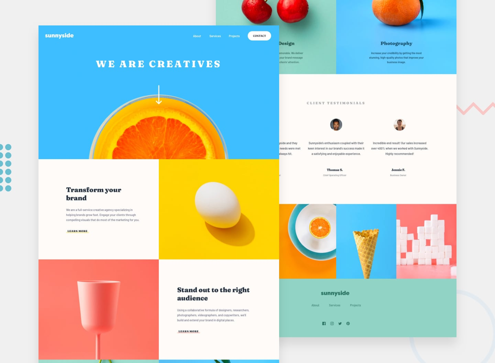
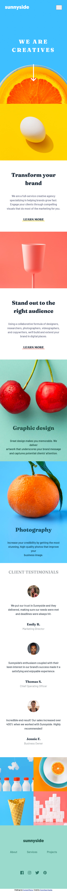

# Frontend Mentor - Sunnyside Agency Landing Page

A responsive landing page for Sunnyside, a creative agency specializing in branding, design, and visual storytelling. This project recreates the provided Frontend Mentor design with a focus on responsive layouts, clean HTML structure, and interactive elements.

## 📋 Table of Contents

- [Overview](#-overview)
- [Features](#-features)
- [Screenshot](#-screenshot)
- [Links](#-links)
- [Built With](#-built-with)
- [What I Learned](#-what-i-learned)
- [Continued Development](#-continued-development)
- [Useful Resources](#-useful-resources)
- [Author](#-author)
- [Acknowledgments](#-acknowledgments)

## 🎯 Overview

The goal of this project was to build a responsive landing page that closely matches the supplied desktop and mobile designs.

The page showcases Sunnyside's creative services through engaging visual sections, promotional content, client testimonials, and a footer with navigation links and social media icons.

### Features

- Responsive layout for desktop and mobile devices.
- Mobile navigation menu with a toggle interaction.
- Interactive hover states for links and buttons.
- Visually engaging sections featuring images and typography.
- Client testimonials section.
- Responsive image layouts for different screen sizes.
- Structured and reusable CSS styling.

## 📸 Screenshot

Add a screenshot of your completed project to the repository and update the path below.

## 🔗 Links

- **Live Site:** [View Live Demo]()
- **GitHub Repository:** [View Source Code](https://github.com/Tonye-Onuoha/Agency-Landing-Page.git)
- **Frontend Mentor Challenge:** [View Challenge](https://www.frontendmentor.io/challenges/agency-landing-page-7yVs3B6ef)

> Replace the placeholder URLs with your actual deployment and repository links.

## 🛠️ Built With

- **HTML5** — Semantic markup and page structure.
- **CSS3** — Styling, responsive layouts, and interactive hover effects.
- **JavaScript** — Mobile navigation toggle.
- **Mobile-first design principles** — Creating layouts that adapt to different screen sizes.

## 📚 What I Learned

This project provided an opportunity to practice and strengthen my front-end development skills, particularly in:

- Building responsive layouts that adapt to different viewport sizes.
- Using CSS Flexbox and Grid where appropriate to organize page sections.
- Implementing interactive navigation with JavaScript.
- Managing spacing, typography, and visual hierarchy to match a reference design.
- Applying hover states to improve the user experience.
- Organizing HTML and CSS for readability and maintainability.

## 🚀 Continued Development

Areas I would like to continue improving include:

- Refining responsive layouts across a wider range of screen sizes.
- Improving accessibility through semantic HTML, keyboard navigation, and appropriate ARIA attributes where needed.
- Ensuring consistent styling and reusable CSS patterns.
- Optimizing images and other assets for better performance.
- Improving JavaScript interactions and overall usability.

## 📖 Useful Resources

- [Frontend Mentor](https://www.frontendmentor.io/) — A platform for practicing front-end development through real-world design challenges.
- [MDN Web Docs](https://developer.mozilla.org/) — Documentation and guides for HTML, CSS, and JavaScript.
- [CSS-Tricks](https://css-tricks.com/) — Articles and practical guides on modern CSS techniques.

## 👨‍💻 Author

**Tonye Hugo Onuoha**

- GitHub: [GITHUB_USERNAME](https://github.com/Tonye-Onuoha)
- Frontend Mentor: [FRONTEND_MENTOR_USERNAME](https://www.frontendmentor.io/profile/Tonye-Onuoha)

## 🙏 Acknowledgments

Thanks to [Frontend Mentor](https://www.frontendmentor.io/) for providing the design challenge and assets used to build this project.

---

⭐ If you find this project helpful or interesting, feel free to explore the repository!
